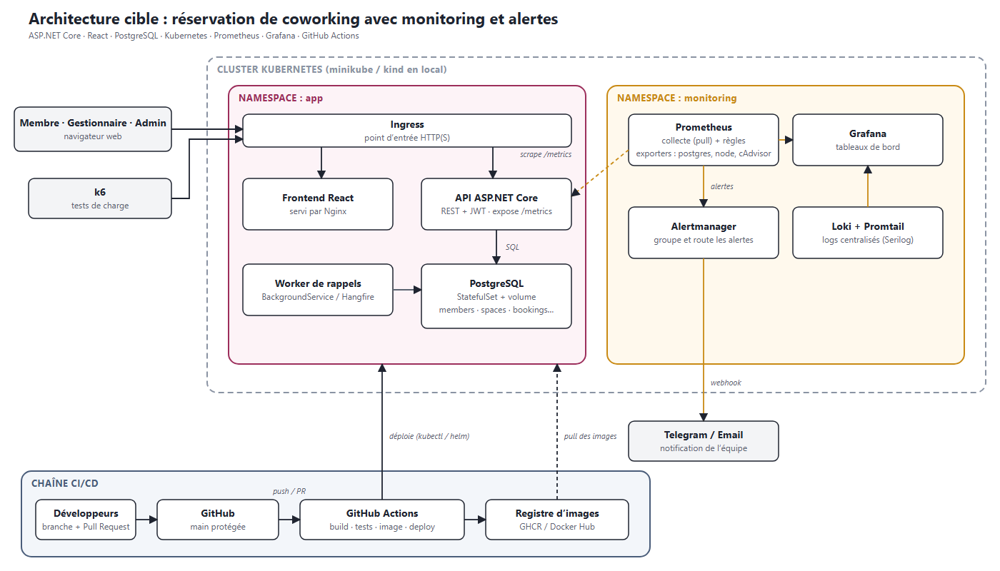

# Réservation de coworking avec monitoring et alertes

Projet DevOps réalisé en binôme (ENSA Fès). Les membres d'un espace de coworking réservent une salle de réunion, un bureau privé ou un poste de travail selon la capacité, les équipements et les créneaux réellement libres. L'application est déployée sur Kubernetes et surveillée en continu par Prometheus et Grafana, avec des alertes automatiques.

> **État du projet : semaine 1 (cadrage).** Le code applicatif n'existe pas encore. Les dossiers ci-dessous sont des emplacements prévus.

## Problématique

Deux questions guident le projet :

1. Comment permettre une réservation fiable, sans double réservation d'un même espace sur un même créneau ?
2. Comment savoir qu'une application en production est en bonne santé, sans attendre qu'une utilisatrice se plaigne ?

## Architecture cible



Version vectorielle : [docs/architecture.svg](docs/architecture.svg)

## Stack

| Couche | Technologie |
|---|---|
| Frontend | React |
| Backend | ASP.NET Core (API REST, JWT) |
| Base de données | PostgreSQL |
| Conteneurs et orchestration | Docker, Kubernetes (minikube ou kind en local), Helm |
| Monitoring | Prometheus, Grafana, Alertmanager, Loki |
| CI/CD | GitHub Actions |
| Tests de charge | k6 |

## Structure du dépôt

```
backend/      API ASP.NET Core (à venir)
frontend/     application React (à venir)
k8s/          manifestes Kubernetes ou charts Helm (à venir)
monitoring/   règles Prometheus, dashboards Grafana, config Alertmanager (à venir)
docs/         cahier des charges, schémas, documentation
.github/      workflows CI/CD et template de Pull Request
```

## Planning

| Semaine | Objectif |
|---|---|
| S1 | Cadrage, organisation, dépôt, architecture |
| S2–S3 | API métier : authentification, disponibilités, anti double réservation |
| S4 | Frontend React |
| S5 | Conteneurisation et déploiement Kubernetes |
| S6–S7 | Monitoring : métriques, dashboards |
| S8 | Alertes |
| S9 | Pipeline CI/CD |
| S10 | Tests de charge, rapport, démonstration |

## Démarrage

À compléter dès que le code existe (prérequis, commandes de lancement, accès aux dashboards).

## Contribuer

Voir [CONTRIBUTING.md](CONTRIBUTING.md) pour la stratégie de branches, les conventions de commit et le processus de Pull Request.

## Équipe

- Rim Ben Moussa
- [Nom de la binôme – à compléter]

Encadrant : [à compléter]
