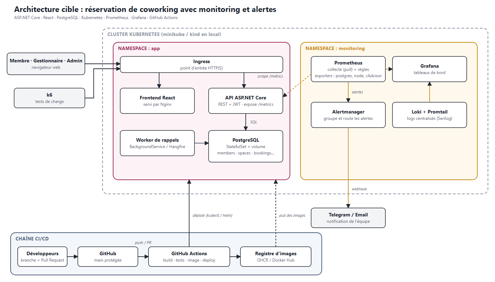

# Réservation de coworking avec monitoring et alertes

Projet DevOps réalisé en binôme (ENSA Fès). Une application de réservation pour un espace de coworking ouvert 24 h/24, inspirée du fonctionnement d'un coworking de Fès : Open Space, terrasse, phone box et salles de réunion. Les clients réservent sans compte et paient au départ selon le temps passé ; le gestionnaire suit l'occupation en direct, fait les check-in / check-out et traite les devis. L'application sera déployée sur Kubernetes et surveillée par Prometheus et Grafana, avec des alertes automatiques.

> **État du projet : semaine 3 (Docker et intégration continue).** L'application complète démarre avec `docker compose up`. Chaque push est testé par GitHub Actions (tests, lint, SonarCloud, scan Trivy), et les images de `main` sont publiées sur GitHub Container Registry. Kubernetes et le monitoring arrivent les semaines suivantes. Détails : [docs/semaine-2.md](docs/semaine-2.md) (application) et [docs/semaine-3.md](docs/semaine-3.md) (Docker, CI).

## Problématique

Deux questions guident le projet :

1. Comment permettre une réservation fiable, sans dépasser la capacité d'un espace ni réserver deux fois la même cabine, même quand deux clients réservent au même moment ?
2. Comment savoir qu'une application en production est en bonne santé, sans attendre qu'un client se plaigne ?

## Architecture cible



Version vectorielle : [docs/architecture.svg](docs/architecture.svg)

## Stack

| Couche | Technologie |
|---|---|
| Frontend | React 19 + Vite + TypeScript, React Router, Axios, CSS modules |
| Backend | ASP.NET Core 10 (Web API, Controllers, JWT), Swagger |
| Base de données | PostgreSQL 17, Entity Framework Core 10 + Npgsql (migrations) |
| Tests | xUnit, EF Core InMemory, FakeTimeProvider, Coverlet |
| Conteneurs | Docker multi-stage (images non-root), docker compose, Nginx |
| CI | GitHub Actions, SonarCloud, Trivy, GitHub Container Registry |
| Orchestration | Kubernetes (minikube ou kind en local), Helm *(à venir)* |
| Monitoring | Prometheus, Grafana, Alertmanager, Loki *(à venir)* |

## Structure du dépôt

```
backend/
  CoworkingBooking.slnx              solution .NET (nouveau format .slnx du SDK 10)
  src/CoworkingBooking.Api/          API : Controllers, Services, Data (DbContext, seed, migrations), Models, DTOs
  tests/CoworkingBooking.Tests/      tests xUnit des services
  Dockerfile                         image de l'API (sdk -> aspnet)
frontend/                            application React (Vite)
  Dockerfile, nginx/                 image du frontend (Vite -> Nginx qui relaie /api)
docker-compose.yml                   PostgreSQL + API + frontend
docs/                                cahier des charges, schémas, documentation par semaine
k8s/                                 manifestes Kubernetes ou charts Helm (à venir)
monitoring/                          règles Prometheus, dashboards Grafana (à venir)
.github/workflows/ci.yml             pipeline CI (tests, lint, Sonar, Trivy, push GHCR)
```

## Démarrage avec Docker (le plus simple)

Seul Docker est nécessaire.

```bash
cp .env.example .env      # remplir POSTGRES_PASSWORD, JWT_KEY (openssl rand -hex 32), ADMIN_EMAIL, ADMIN_PASSWORD
docker compose up --build
```

- Application : http://localhost:8080 (port modifiable avec `FRONTEND_PORT` dans `.env`)
- Gestionnaire : identifiants `ADMIN_EMAIL` / `ADMIN_PASSWORD` du `.env`
- Swagger : http://localhost:5080/swagger, si `SWAGGER_ENABLED=true`
- `docker compose ps` affiche les 3 services `healthy`. `docker compose down -v` efface aussi la base.

Les images publiées par la CI sont sur `ghcr.io/rimbenmoussa/coworking-booking-backend` et `ghcr.io/rimbenmoussa/coworking-booking-frontend`, taggées par SHA de commit. Détails : [docs/semaine-3.md](docs/semaine-3.md).

## Démarrage en local (développement, sans Docker pour l'API)

### Prérequis

| Outil | Version testée | Vérification |
|---|---|---|
| .NET SDK | 10.0 | `dotnet --version` |
| Outil EF Core | 10.x | `dotnet ef --version` (sinon `dotnet tool install --global dotnet-ef`) |
| Node.js / npm | 24 / 11 | `node -v`, `npm -v` |
| Docker | 28 | `docker --version` (pour PostgreSQL) |

### 1. Lancer PostgreSQL

```bash
docker run -d --name coworking-pg \
  -e POSTGRES_USER=coworking -e POSTGRES_PASSWORD=coworking_dev -e POSTGRES_DB=coworking \
  -p 5432:5432 postgres:17
```

Les fois suivantes : `docker start coworking-pg`.

### 2. Configurer et lancer l'API

```bash
cd backend/src/CoworkingBooking.Api
cp appsettings.Development.example.json appsettings.Development.json
# Remplacer Jwt:Key par une valeur aléatoire, par exemple : openssl rand -hex 32
```

`appsettings.Development.json` est ignoré par git : il ne doit jamais être commité. En dehors du développement, la configuration passe par des variables d'environnement : `ConnectionStrings__Default`, `Jwt__Key`, `Admin__Email`, `Admin__Password`, `Frontend__Url` (voir la section `backend` de [docker-compose.yml](docker-compose.yml)).

```bash
cd backend
dotnet ef database update -p src/CoworkingBooking.Api     # crée les tables, les espaces et les tarifs
dotnet run --project src/CoworkingBooking.Api --launch-profile http
```

- API : http://localhost:5080
- Swagger : http://localhost:5080/swagger
- Santé : http://localhost:5080/health (le processus répond) et http://localhost:5080/ready (PostgreSQL joignable)

En développement, `Database:MigrateOnStartup` vaut `true` : la migration est aussi appliquée au démarrage de l'API.

### 3. Lancer le frontend

```bash
cd frontend
cp .env.example .env.development.local   # VITE_API_URL=http://localhost:5080
npm install
npm run dev
```

Application : http://localhost:5173

### 4. Lancer les tests

```bash
cd backend
dotnet test                                                        # 107 tests
dotnet test --settings coverlet.runsettings --collect:"XPlat Code Coverage"   # avec couverture (TestResults/)

cd ../frontend
npm run build                                                      # vérification TypeScript + build
npm run lint
```

### Comptes de test

| Rôle | Identifiants | Remarque |
|---|---|---|
| Gestionnaire | `gestionnaire@coworking.local` / `Gestion2026!` | Valeurs de `appsettings.Development.example.json`, créées au démarrage de l'API. À changer hors développement. |
| Client | aucun compte | Réservation avec nom + téléphone mobile marocain (06/07…). |

## Planning

| Semaine | Objectif |
|---|---|
| S1 | Cadrage, organisation, dépôt, architecture, modèle de données |
| S2 | Application de bout en bout : API, frontend, PostgreSQL, tests ✅ |
| S3 | Docker, docker compose, CI GitHub Actions, SonarCloud, Trivy, GHCR ✅ |
| S4 – S6 | Kubernetes, monitoring et alertes, tests de charge, démonstration |

## Contribuer

Voir [CONTRIBUTING.md](CONTRIBUTING.md) pour la stratégie de branches, les conventions de commit et le processus de Pull Request.

## Équipe

- Rim Ben Moussa
- Khadija Alaoui Mrani

Encadrant : Youssef Aounzo
