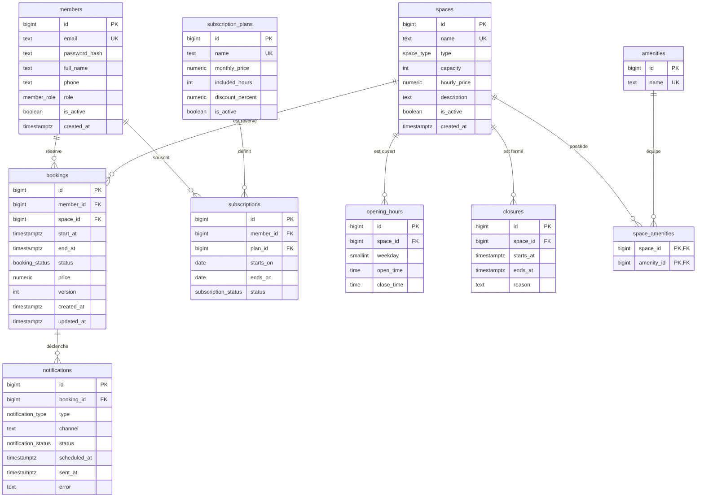

# Modèle de données

Base **PostgreSQL 15+**. Les fichiers de référence sont dans [`db/`](../db) :

| Fichier | Rôle |
|---|---|
| [`db/schema.sql`](../db/schema.sql) | Création des types, tables, contraintes et index |
| [`db/seed.sql`](../db/seed.sql) | Données de démonstration (développement uniquement) |
| [`db/tests.sql`](../db/tests.sql) | Tests des contraintes (annulés par `ROLLBACK`, la base reste intacte) |
| [`db/queries.sql`](../db/queries.sql) | Requêtes de référence : disponibilités, quota d'heures, planning, occupation, rappels |

## Diagramme entité-relation



## Les tables

| Table | Rôle | Remarques |
|---|---|---|
| `members` | Comptes : membres, gestionnaires, administrateurs | Rôle dans `role`. Email unique **sans tenir compte de la casse**. Mot de passe stocké haché uniquement. |
| `spaces` | Espaces réservables | `type` : salle de réunion, bureau privé ou poste flex. Capacité strictement positive, prix horaire positif ou nul. |
| `amenities`, `space_amenities` | Équipements et leur association aux espaces | Table de référence plutôt qu'une liste libre : pas de fautes de frappe, recherche par identifiant. |
| `opening_hours` | Horaires d'ouverture hebdomadaires par espace | `weekday` de 1 (lundi) à 7 (dimanche). Plusieurs plages par jour possibles (pause déjeuner). |
| `closures` | Fermetures exceptionnelles (maintenance, jours fériés) | Bloquent les créneaux concernés. |
| `subscription_plans`, `subscriptions` | Abonnements des membres | Un plan définit un forfait d'heures incluses et une remise. Un membre ne peut pas avoir deux abonnements actifs sur la même période. |
| `bookings` | Réservations | Statuts : `pending`, `confirmed`, `used`, `cancelled`, `no_show`. Colonne `version` pour le contrôle de concurrence optimiste. |
| `notifications` | Confirmations, rappels, annulations | Une seule notification par réservation, type et canal : un rappel ne part pas deux fois. |

## Décisions de conception

**1. La double réservation est interdite par la base, pas par le code.**
La contrainte `bookings_no_overlap` est une contrainte d'exclusion (`EXCLUDE USING gist`) : deux réservations *actives* du même espace ne peuvent pas avoir de plages qui se chevauchent. Un contrôle fait seulement dans l'API (« vérifier puis insérer ») laisserait passer deux requêtes simultanées ; avec cette contrainte, la seconde est refusée par PostgreSQL (erreur `23P01`), que l'API traduit en `409 Conflict` (US-08).

**2. Plages semi-ouvertes `[début, fin)`.**
Une réservation de 10h à 11h et une autre de 11h à 12h sont compatibles.

**3. Seuls `pending`, `confirmed` et `used` bloquent un créneau.**
Une réservation `cancelled` ou `no_show` libère l'espace pour d'autres membres.

**4. Horodatages en `timestamptz`.**
PostgreSQL stocke tout en UTC. Les horaires d'ouverture (`time`) sont des heures **locales du site** : la requête de disponibilité reçoit le fuseau du site (par exemple `Africa/Casablanca`) et fait la conversion.

**5. Abonnements sans paiement.**
Le cahier des charges exclut le paiement et la facturation. `subscriptions` sert uniquement à calculer le prix d'une réservation (remise) et le quota d'heures du mois (requête n°2 de `db/queries.sql`).

**6. Types énumérés PostgreSQL** (`booking_status`, `space_type`, etc.) plutôt que des textes libres : les valeurs invalides sont refusées par la base.

## Vérifications effectuées

Le schéma a été chargé sur PostgreSQL 17 (conteneur Docker) avec les données de démonstration, puis :

- **11 tests de contraintes** passent (`db/tests.sql`) : chevauchement refusé, réservations adjacentes acceptées, même créneau sur un autre espace accepté, créneau d'une réservation annulée réutilisable, plage inversée refusée, horaires incohérents refusés, email en double refusé, abonnements actifs simultanés refusés, capacité nulle refusée, `updated_at` mis à jour.
- **Test de concurrence réel** : deux sessions réservent le même créneau en même temps. La seconde attend la fin de la transaction de la première, puis est refusée ; il reste une seule réservation.
- **Requêtes de référence** exécutées avec des cas limites : espace déjà réservé, équipement manquant, samedi (seules les salles de réunion ouvrent), jour de fermeture.

## Limites connues

- Une réservation ne peut pas traverser minuit (la requête de disponibilité exige le même jour local).
- Le prix d'une réservation est calculé par l'API et figé dans `bookings.price` ; il n'y a pas d'historique des changements de tarif des espaces.
- `closures.space_id` est obligatoire : fermer tout le site revient à créer une fermeture par espace.
- `schema.sql` est la référence tant que le backend n'existe pas. Une fois l'API créée, les migrations Entity Framework Core prendront le relais et devront rester équivalentes à ce schéma, contraintes d'exclusion comprises (EF Core ne les génère pas seul : elles se déclarent en SQL dans la migration).

## Reproduire en local

```bash
docker run -d --name coworking-pg -e POSTGRES_PASSWORD=test -e POSTGRES_DB=coworking -p 5432:5432 postgres:17
docker cp db coworking-pg:/db
docker exec coworking-pg psql -U postgres -d coworking -v ON_ERROR_STOP=1 -f /db/schema.sql
docker exec coworking-pg psql -U postgres -d coworking -v ON_ERROR_STOP=1 -f /db/seed.sql
docker exec coworking-pg psql -U postgres -d coworking -v ON_ERROR_STOP=1 -f /db/tests.sql
```
